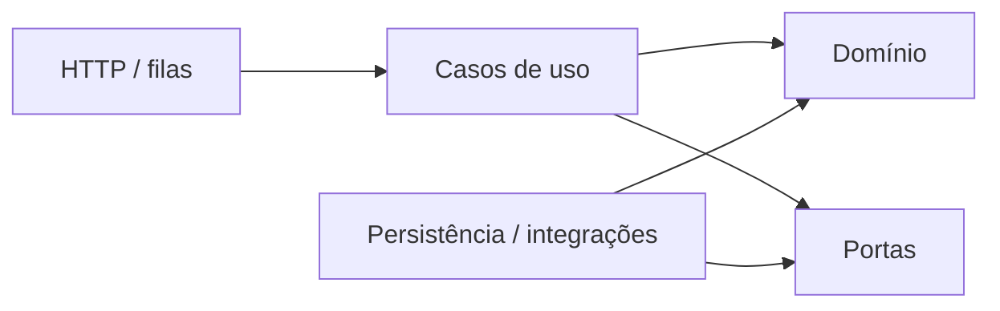

Atualizado: 14/11/2026
# Organização arquitetural de um projeto backend

Ao criar um novo backend, agrupe o código por módulos de negócio, mantenha as dependências orientadas e defina os controles de segurança desde o desenho. Os caminhos representam o **projeto destino**. A árvore usa Node.js e TypeScript como exemplo; preserve as convenções da linguagem e do framework escolhidos, adaptando extensões, pacotes, injeção de dependências e diretórios em Java/Spring, C#/.NET, Python/FastAPI, Go ou outra stack.

## 1. Organize o projeto por módulos e casos de uso

Adote um **monólito modular** como ponto de partida quando os requisitos permitirem uma aplicação implantada como uma unidade, com módulos internos responsáveis por capacidades de negócio. Identifique os limites pelo vocabulário, pelas regras e pela propriedade dos dados. Evite criar um módulo para cada tabela ou concentrar todo o backend em pastas globais de controladores, serviços e repositórios.

Dentro de cada módulo, agrupe os arquivos de uma operação pelo caso de uso e mantenha próximas as responsabilidades que mudam pelo mesmo motivo. Essa organização adapta o agrupamento por **fatias verticais** de [Vertical Slice Architecture](https://www.jimmybogard.com/vertical-slice-architecture/). Aplique também a inversão de dependências de [Ports & Adapters](https://alistair.cockburn.us/hexagonal-architecture) e [Clean Architecture](https://blog.cleancoder.com/uncle-bob/2012/08/13/the-clean-architecture.html): os adaptadores conhecem os contratos do núcleo; o núcleo permanece independente dos detalhes de transporte e persistência.

```text
projeto/
├── src/
│   ├── app/                        # Composição, inicialização e ciclo de vida
│   │   ├── server.ts               # Configuração do servidor e middlewares globais
│   │   ├── container.ts            # Composition Root: criação e conexão das dependências
│   │   ├── routes.ts               # Registro das rotas e versões da API
│   │   └── workers.ts              # Inicialização e encerramento de workers
│   ├── config/                     # Leitura e validação da configuração de ambiente
│   ├── modules/
│   │   ├── auth/                   # Exemplo de identidade e autenticação
│   │   ├── users/                  # Exemplo de gestão de usuários
│   │   └── orders/                 # Exemplo de gestão de pedidos
│   │       ├── http/               # Rotas, controladores e validação de transporte
│   │       ├── jobs/               # Consumidores de mensagens e tarefas do módulo
│   │       ├── use-cases/          # Operações da aplicação, agrupadas por intenção
│   │       │   ├── create-order/
│   │       │   │   ├── create-order.use-case.ts
│   │       │   │   ├── create-order.contracts.ts
│   │       │   │   └── create-order.use-case.test.ts
│   │       │   └── get-order-summary/
│   │       ├── domain/             # Entidades, valores, invariantes e eventos internos
│   │       ├── ports/              # Interfaces exigidas pelos casos de uso
│   │       ├── repositories/       # Implementações de persistência e consultas
│   │       ├── integrations/       # Adaptadores de serviços externos do módulo
│   │       ├── dtos/               # Payloads e esquemas de validação de transporte
│   │       ├── mappers/            # Conversões entre transporte, aplicação e banco
│   │       ├── module.ts           # Fábrica que conecta os componentes internos
│   │       ├── contracts.ts        # Contratos públicos de negócio, quando necessários
│   │       └── index.ts            # Entrada pública de composição do módulo
│   ├── shared/
│   │   ├── kernel/                 # Primitivas puras e estáveis realmente compartilhadas
│   │   ├── infra/                  # Clientes técnicos de banco, cache e mensageria
│   │   ├── http/                   # Middlewares genéricos e respostas HTTP comuns
│   │   └── utils/                  # Funções puras sem conhecimento dos módulos
│   └── testing/                    # Fábricas, fakes e helpers de teste compartilhados
├── database/                       # Migrações, seeds e schemas conforme a ferramenta
└── tests/
    ├── integration/                # Persistência e fluxos com dependências reais isoladas
    ├── e2e/                        # Jornadas completas que precisem dessa cobertura
    └── architecture/               # Verificações das fronteiras de dependência
```

Substitua `auth`, `users` e `orders` pelos contextos reais do sistema. Crie somente os diretórios e mecanismos necessários. Um CRUD pequeno pode começar com uma função de caso de uso, um adaptador de entrada e a persistência em poucos arquivos. Extraia `domain/`, portas e subdivisões conforme surgirem regras, dependências e responsabilidades distintas; preserve desde o início validação, autorização e propriedade dos dados. Uma função injetada pode representar uma porta sem exigir uma pasta ou interface dedicada.

Use conceitos de **Domain-Driven Design (DDD)** quando ajudarem a representar o negócio: entidades com identidade, objetos de valor, agregados e contextos delimitados. Confirme os limites semânticos antes de tratar cada módulo como um *Bounded Context*. Introduza um *Shared Kernel* apenas para conceitos estáveis cuja manutenção seja de fato compartilhada.

Preserve o layout nativo quando o framework exigir outros caminhos. Em Go, por exemplo, adapte a composição a `cmd/` e os pacotes privados a `internal/`, conforme o [guia oficial de organização](https://go.dev/doc/modules/layout). Registre adaptações relevantes em uma ADR do projeto destino. A escolha de monólito, serviços independentes ou outra forma de implantação deve considerar requisitos e custos operacionais, conforme a discussão de [Monolith First](https://martinfowler.com/bliki/MonolithFirst.html).

## 2. Defina onde cada código deve ficar

| Código ou responsabilidade | Local no projeto | Regra de organização |
|---|---|---|
| Inicialização, registro de rotas, dependências e encerramento | `src/app/` | Compor os módulos e administrar recursos sem concentrar regras de negócio |
| Leitura e validação de variáveis de ambiente | `src/config/` | Produzir configuração validada e injetar os valores necessários |
| Controlador HTTP de pedidos | `src/modules/orders/http/` | Traduzir a requisição, chamar a operação e formatar a resposta |
| Consumidor de fila ou tarefa agendada de pedidos | `src/modules/orders/jobs/` | Validar a mensagem e delegar o processamento ao caso de uso |
| Criação, aprovação ou cancelamento de pedido | `src/modules/orders/use-cases/` | Coordenar autorização, domínio, portas, transação e efeitos da operação |
| Cálculo de desconto e transições de estado do pedido | `src/modules/orders/domain/` | Proteger invariantes sem importar HTTP, ORM ou SDKs |
| Interfaces de persistência, relógio, transação ou serviço externo | `src/modules/orders/ports/` | Expressar o que a aplicação precisa com tipos independentes da tecnologia |
| Consultas SQL e implementações com ORM | `src/modules/orders/repositories/` | Implementar as portas e acessar somente os dados pertencentes ao módulo |
| Integração de pedidos com um provedor externo | `src/modules/orders/integrations/` | Traduzir o protocolo externo para a porta definida pelo módulo |
| Payloads e esquemas Zod, Joi ou Pydantic de transporte | `src/modules/orders/dtos/` | Validar dados externos e manter o contrato separado do domínio |
| Entrada e resultado puros de uma operação | Junto do caso de uso em `use-cases/` | Permitir a mesma operação por HTTP, fila ou chamada interna |
| Conversão de registro de banco, domínio e resposta | `src/modules/orders/mappers/` | Manter cada conversão na fronteira que conhece as duas representações |
| Contratos de negócio consumidos fora do módulo | `src/modules/orders/contracts.ts` | Expor somente tipos estáveis, sem entidades privadas ou tipos do ORM |
| Conexão de banco, cliente Redis ou transporte de mensagens | `src/shared/infra/` | Compartilhar mecanismos técnicos sem conhecer regras dos módulos |
| Primitivas puras e tratamento HTTP genérico | `src/shared/kernel/` e `src/shared/http/`, respectivamente | Separar conceitos de domínio de convenções de transporte |
| Migrações e dados iniciais | `database/` ou caminho nativo da ferramenta | Identificar o módulo dono e preservar o histórico de evolução do schema |
| Testes de uma regra ou operação | Junto do código correspondente | Manter a manutenção próxima da responsabilidade testada |

Reserve `ports/` às interfaces e `repositories/` às implementações. Se a stack colocar interfaces de repositório no domínio, preserve uma direção equivalente e documente a convenção. O caso de uso deve depender do contrato, sem receber sessões, modelos ou tipos exclusivos do ORM.

Promova código a `shared/` quando houver uso real em contextos independentes e uma responsabilidade estável. Se uma função exige conhecer pedidos para ser compreendida, mantenha-a em `modules/orders/`. Evite classes base, repositórios genéricos e interfaces criados apenas para preencher a estrutura.

Proteja o contrato externo com mapeamento explícito dos campos publicados. Uma mudança de coluna, relacionamento ou modelo do ORM deve ser absorvida no adaptador de persistência. Separe mapeadores por finalidade quando necessário; evite um arquivo global que conheça simultaneamente todos os módulos, o banco e os protocolos de entrada.

## 3. Proteja as fronteiras de dependência

Aplique isolamento entre módulos e direção de dependência para o núcleo. As regras específicas de cada responsabilidade restringem a permissão geral do módulo:

| Origem da importação | Pode depender de | Não pode depender de |
|---|---|---|
| `app/` | Entradas públicas dos módulos, `shared/` e `config/` | Arquivos privados dos módulos |
| Um módulo, como regra geral | Seus arquivos internos e recursos compartilhados permitidos à sua responsabilidade; nos adaptadores, tipos de contratos públicos de outro módulo com dependência declarada | `app/`, arquivos privados ou entrada de composição de outro módulo |
| `domain/` | Biblioteca padrão, bibliotecas puras justificadas, código puro local e primitivas de `shared/kernel/` | Casos de uso, portas de infraestrutura, transporte, configuração de ambiente, ORM ou SDKs |
| `use-cases/` | Domínio, portas, contratos puros locais e utilitários puros necessários | Controladores, esquemas de transporte, implementações de persistência, `shared/infra/` ou `config/` |
| `ports/` | Tipos puros locais, domínio e primitivas compartilhadas necessárias | Implementações concretas, HTTP, tipos do ORM ou SDKs |
| `http/` e `jobs/` | Casos de uso, DTOs, mapeadores, erros de domínio locais e recursos técnicos de entrada; tipos de `contracts.ts` de outro módulo quando declarados | Repositórios concretos e execução direta de regras de negócio ou integrações de saída |
| `repositories/` e `integrations/` | Portas, domínio, mapeadores próprios e clientes de `shared/infra/`; tipos de `contracts.ts` de outro módulo quando declarados | Internos de outros módulos e `app/` |
| `contracts.ts` público | Tipos puros locais necessários ao contrato | DTOs dependentes de framework, entidades privadas, ORM e composição do módulo |
| `shared/kernel/` e `shared/utils/` | Código puro e outros recursos puros necessários, sem ciclos | Infraestrutura, HTTP, configuração de ambiente, módulos e `app/` |
| `shared/infra/` e `shared/http/` | Recursos compartilhados necessários e `config/`, sem ciclos | Módulos e `app/` |
| `config/` | Leitura de ambiente e bibliotecas necessárias à validação | Módulos, `shared/infra/` e `app/` |

Use `module.ts` como fábrica interna para conectar as implementações às portas e montar os adaptadores de entrada. A fábrica pode importar os componentes concretos do próprio módulo. Mantenha em `app/container.ts` a composição entre módulos e a criação dos recursos transversais; essa permissão de composição não se estende aos casos de uso.

O diagrama representa dependências de código. Em execução, o caso de uso chama a implementação injetada por meio da porta:



### Entrada pública do módulo

Exponha uma fábrica ou fachada pequena, com exportações nomeadas e explícitas. Para TypeScript, use `index.ts` como entrada de composição. Quando houver contratos consumidos por outros módulos, ofereça uma entrada separada `contracts.ts`, livre de inicialização, conexões e dependências de transporte:

```typescript
// src/modules/orders/index.ts
export { createOrdersModule } from './module';
export type { OrderSummary } from './contracts';
```

```typescript
// src/modules/orders/contracts.ts
export type { OrderSummary } from './use-cases/get-order-summary/order-summary';
```

Exporte apenas os contratos realmente necessários. Prefira dados simples e imutáveis nas fronteiras, com representações documentadas para datas, valores monetários e identificadores. Evite expor entidades mutáveis, registros do ORM, objetos de requisição ou o contêiner de dependências.

Em outras linguagens, aplique a fronteira por pacotes, assemblies, interfaces públicas e visibilidade nativa. O [modificador `internal` de C#](https://learn.microsoft.com/en-us/dotnet/csharp/language-reference/keywords/internal) atua no assembly; o diretório `internal/` de Go limita a árvore de importadores permitidos. Complete esses mecanismos com regras arquiteturais quando vários módulos compartilharem a mesma fronteira de compilação.

### Caminhos de importação

- Dentro do módulo, use caminhos relativos para consumir seus arquivos privados, sem retornar pelo próprio `index.ts`.
- Em TypeScript, use `@/` para recursos compartilhados e, em `app/`, para entradas públicas dos módulos. Nos adaptadores, permita também `import type` de `@/modules/<outro-modulo>/contracts` quando essa dependência estiver declarada. Configure o alias no compilador, no executor e nos testes.
- Conecte chamadas de negócio entre módulos por portas locais injetadas na composição. Evite importar a fábrica ou um caso de uso concreto de outro módulo dentro do consumidor.
- Quando um adaptador precisar de tipos de dados ou eventos públicos de outro módulo, declare essa dependência e limite-a a `contracts.ts`. Em TypeScript, use `import type`, sem valores de runtime ou inicialização do fornecedor. Valide as mensagens recebidas na borda; o tipo importado não valida o payload. Preserve domínio, portas e casos de uso independentes de contratos de outros módulos. Em outras linguagens, aplique a mesma fronteira por contratos de dados sem efeitos de inicialização.
- Bloqueie o acesso a internos também por caminhos relativos, aliases alternativos, reexportações e importações de tipos. Evite `export *` e barrels que exponham toda a aplicação.

A existência de `index.ts` não aplica encapsulamento automaticamente. Verifique as entradas permitidas e o grafo de dependências com ferramentas compatíveis com a stack.

### Comunicação e propriedade dos dados

Cada módulo é dono de suas tabelas, coleções, gravações e regras. Compartilhar um banco físico é compatível com essa organização. Impeça consultas, joins e alterações diretas nas estruturas privadas de outro módulo, inclusive em relatórios; use uma consulta pública ou uma projeção com proprietário definido.

Para uma consulta síncrona, defina no módulo consumidor uma porta como `CustomerGateway`. Conecte-a à capacidade pública de `users` na composição. Neste trecho ilustrativo, considere `database` já inicializado e fábricas que ofereçam as dependências e capacidades mostradas:

```typescript
// src/app/container.ts
import { createOrdersModule } from '@/modules/orders';
import { createUsersModule } from '@/modules/users';

const users = createUsersModule({ database });

const orders = createOrdersModule({
  database,
  customerGateway: {
    exists: (customerId: string) => users.customerQueries.exists(customerId),
  },
});
```

O caso de uso de pedidos conhece somente sua porta e recebe o resultado necessário. A chamada pública dentro do mesmo processo pode ser uma chamada de função; acrescente transporte de rede quando a implantação exigir essa fronteira.

Para comunicação assíncrona, diferencie **eventos de domínio**, internos ao modelo, de **eventos de integração**, contratos públicos entre módulos ou sistemas. Converta e publique somente os dados necessários, com identificador e estratégia de evolução do contrato. O produtor informa o fato ocorrido sem conhecer seus consumidores. Use publicação durável para efeitos que precisem sobreviver a falhas, conforme a seção de consistência.

Mantenha o grafo de dependências sem ciclos. Quando uma operação atravessar módulos, atribua a coordenação a um caso de uso do módulo responsável pelo processo e injete suas portas em `app/`. Evite deslocar regras para a composição ou para `shared/` apenas para contornar uma dependência circular.

## 4. Separe validação, regras e orquestração

### Validação na borda e invariantes

Valide formato, tipo, limites de tamanho e campos permitidos em tempo de execução na entrada HTTP, mensagem ou integração. Tipagem estática não valida dados externos. Em `dtos/`, mantenha os esquemas e contratos do transporte; converta-os para entradas puras do caso de uso.

Proteja as invariantes no domínio ou na operação responsável, independentemente da entrada utilizada. Uma quantidade positiva pode ser validada no payload e também na construção de um objeto de valor. Uma regra como impedir o cancelamento de um pedido enviado deve continuar válida em chamadas por fila, tarefas e testes.

Mantenha regras que exigem consultas ou coordenação no caso de uso, usando portas. Uma verificação de unicidade antes de gravar precisa ser complementada pela restrição correspondente no banco para suportar concorrência. Traduza a violação técnica para um erro conhecido da aplicação.

### Casos de uso com uma intenção clara

Organize cada operação por uma intenção, como `CreateOrder`, `ApproveOrder` ou `CancelOrder`. Use funções ou classes conforme a stack; acrescente mediadores, buses e contêineres somente quando houver uma responsabilidade concreta para eles.

Siga o fluxo aplicável à operação: receber entrada validada → verificar permissões iniciais → carregar dados pelas portas → autorizar o acesso ao recurso e verificar suas condições → executar regras → persistir na fronteira transacional → disponibilizar efeitos confirmados. Defina o limite da transação conforme as garantias necessárias; revalide dentro dele as condições que possam mudar concorrentemente.

Injete as dependências necessárias. Evite buscar serviços em um contêiner global ou ler variáveis de ambiente durante a regra. Quando relógio, geração de IDs ou provedor externo influenciarem o comportamento, receba uma função ou porta que permita controlar essa dependência nos testes.

Mantenha cada operação coesa. Separe relatórios, escrita e integrações quando tiverem motivos distintos para mudar, evitando um `OrderService` que concentre todas as responsabilidades do módulo.

### Leitura e escrita proporcionais ao problema

Aplique **CQRS pragmático** quando a separação simplificar o modelo. Nas escritas, execute as regras e preserve a consistência; use entidades e agregados quando houver comportamento que justifique esse modelo. Nas leituras, permita projeções e consultas otimizadas que retornem DTOs próprios, sem reconstruir agregados desnecessários.

Mantenha a implementação SQL ou ORM da leitura em `repositories/`, atrás de uma porta de consulta. Preserve a autorização, o escopo do tenant e a propriedade dos dados também nas listagens e nos relatórios.

Separe modelos de leitura e escrita sem exigir bancos diferentes, processamento assíncrono ou Event Sourcing. Avalie o custo antes de ampliar essa separação, conforme as [considerações de CQRS](https://martinfowler.com/bliki/CQRS.html).

## 5. Organize estado, transações e consistência

Projete processos HTTP e workers para reinício e execução em múltiplas instâncias. Persista o estado necessário à continuidade fora da memória local. Conexões, caches descartáveis e contexto de uma execução podem permanecer no processo quando sua perda e seu escopo forem controlados. Registre requisitos específicos se a aplicação precisar de processamento com estado ou afinidade de sessão.

| Natureza do estado ou dado | Onde manter e como gerenciar |
|---|---|
| Identidade autenticada, tenant e correlação da execução | Contexto com escopo da requisição ou mensagem; transmitir explicitamente os dados necessários à decisão de negócio |
| Estado durável e invariantes transacionais | Banco com restrições e transação delimitada pelo caso de uso |
| Sessões e limites que precisam valer entre instâncias | Armazenamento compartilhado apropriado, com expiração e política de consistência definidas |
| Cache de leitura | Adaptador de cache com chaves por módulo e, quando aplicável, tenant; definir TTL e invalidação |
| Tarefas longas e retentativas | Mensageria ou agendador durável, com consumidores idempotentes e política de falha |
| Estado de negócio e evento que precisam ser confirmados juntos | Transação com outbox ou mecanismo equivalente que ofereça a garantia necessária |

Use [AsyncLocalStorage](https://nodejs.org/api/async_context.html) ou o mecanismo apropriado da stack para correlação e metadados de execução. Inicialize e encerre o escopo em cada entrada, inclusive nos workers. Preserve cancelamento e prazos conforme as convenções da linguagem. Receba ator, tenant e demais dados relevantes explicitamente no caso de uso quando eles influenciarem autorização ou regras; mantenha o domínio independente de um contexto global implícito.

### Fronteira transacional e concorrência

Faça o caso de uso determinar quais alterações precisam ser atômicas. Quando necessário, defina uma porta de transação ou **Unit of Work**, implementada com o mecanismo nativo do banco ou ORM. Todas as gravações que precisem ser atômicas entre si devem usar a mesma transação efetiva; repassar a execução a outro cliente pode quebrar essa garantia.

Proteja invariantes concorrentes com constraints, atualização condicional, versão otimista, bloqueio ou nível de isolamento adequado ao problema. Uma consulta de saldo ou existência, isoladamente, não reserva um recurso. Use uma operação atômica de reserva quando o processo exigir essa garantia.

Mantenha transações curtas. Coordene serviços externos e múltiplos armazenamentos com uma estratégia explícita de consistência e compensação quando necessário. Uma transação local de banco cobre somente os recursos participantes dela.

### Publicação durável e processamento idempotente

Quando a confirmação de negócio exigir uma notificação durável, aplique **Transactional Outbox**: grave a mudança e o registro do evento na mesma transação; publique por um processo separado com retentativas e acompanhamento de progresso. A publicação posterior simples deixa uma janela de perda entre o commit e o envio. O barramento em memória serve para efeitos cujo escopo e perda sejam aceitáveis.

Projete o consumidor para mensagens duplicadas. Quando possível, registre a deduplicação e o efeito no mesmo limite transacional; para provedores externos, use o mecanismo de idempotência oferecido e uma estratégia de recuperação. Configure limites de tentativas, backoff, tratamento de mensagens não processáveis e alertas. Outbox não elimina duplicação nem torna todas as operações distribuídas uma única transação. Consulte as [garantias e limitações do padrão](https://docs.aws.amazon.com/prescriptive-guidance/latest/cloud-design-patterns/transactional-outbox.html).

Defina também idempotência para comandos sujeitos a reenvio quando duplicar a operação causar efeitos indevidos. Estabeleça escopo da chave, prazo de retenção e resposta para reuso com payload diferente.

## 6. Mantenha os adaptadores de entrada finos

Em `http/`, extraia e valide os dados, obtenha a identidade verificada, invoque o caso de uso e traduza o resultado para o contrato HTTP. Mantenha decisões de preço, disponibilidade e transição de estado na aplicação ou no domínio. Condições que tratam transporte e respostas continuam sendo responsabilidade do adaptador.

Em `jobs/`, valide o contrato da mensagem e delegue a operação. Confirme o processamento conforme as garantias da fila e do efeito persistido. Trate duplicação, cancelamento e falhas sem esconder mensagens descartadas. Reserve `app/workers.ts` à composição, inicialização e encerramento dos consumidores.

Para GraphQL ou gRPC, crie adaptadores com os nomes e mecanismos nativos da stack, como `graphql/` ou `grpc/`. Reutilize o caso de uso com entradas puras, sem fazer um consumidor de fila simular uma requisição HTTP.

### Erros e contratos de resposta

Defina erros de negócio junto do módulo responsável, como `OrderCannotBeCancelledError`, e mapeie-os na borda. Use `shared/kernel/` somente para abstrações de erro realmente comuns e puras. O domínio não deve escolher status HTTP.

Centralize a execução da tradução dos erros HTTP em um middleware, filtro ou handler genérico de `shared/http/`. Defina os mapeamentos de erros específicos no adaptador HTTP do módulo, onde podem conhecer seus erros de domínio e o contrato de resposta. A fábrica pública pode fornecer esses mapeadores, por exemplo em `errorMappers`; registre-os e injete-os no handler compartilhado pela composição em `app/`. Exponha apenas a capacidade necessária para esse registro, preservando as classes de erro privadas e `shared/http/` sem imports dos módulos.

Defina no handler genérico como percorrer os mapeadores e tratar erros não reconhecidos com uma resposta sanitizada. Defina status conforme o contrato e a causa; validação de payload, conflito de estado e falha inesperada precisam de tratamentos próprios. Mantenha status e formatos HTTP fora do domínio e dos casos de uso.

Adote [RFC 9457 — Problem Details](https://www.rfc-editor.org/rfc/rfc9457.html) para erros de APIs HTTP quando compatível com o contrato, usando `application/problem+json`. Mantenha o campo `status`, quando presente, coerente com o status da resposta. Ofereça identificadores de problema e detalhes úteis ao consumidor; registre diagnóstico interno e stack traces na observabilidade, com acesso restrito e remoção de dados sensíveis. Use o modelo de erro nativo nos demais protocolos.

## 7. Incorpore segurança desde o desenho

Aplique **Security by Design** ao definir os módulos, contratos e fluxos: identifique dados sensíveis, atores, fronteiras de confiança e formas de abuso antes da implementação. Use o [OWASP API Security Top 10, edição 2023](https://owasp.org/projects/api-security-project), como referência de riscos e registre controles, responsáveis e evidências de validação proporcionais ao projeto.

Adote **Defesa em Profundidade**, privilégio mínimo e negação de acesso por padrão. Combine controles na entrada, nos casos de uso, nos dados e na operação. A tabela define a responsabilidade de cada parte:

| Controle | Local no projeto | Regra arquitetural |
|---|---|---|
| Verificação de credenciais e identidade da chamada | Adaptadores de entrada e `shared/http/`, com verificadores injetados | Entregar uma identidade verificada antes de executar operações protegidas |
| Login, renovação e revogação de sessões próprias | Casos de uso, portas e adaptadores de `modules/auth/`, quando esse módulo existir | Manter o ciclo de vida da identidade sob um responsável explícito ou delegá-lo ao provedor escolhido |
| Permissões de função, recurso, propriedade e tenant | `use-cases/`, políticas puras de `domain/` e portas de consulta com escopo | Autorizar a operação e restringir os dados acessíveis pelo ator |
| Validação de payloads e minimização de respostas | `dtos/` e `mappers/` do módulo | Permitir explicitamente os campos aceitos e publicados |
| Consultas seguras e isolamento dos registros | `repositories/`, políticas do banco e migrações | Parametrizar valores e preservar o escopo autorizado em leituras e gravações |
| Requisições de saída e proteção contra SSRF | `integrations/` do módulo e cliente técnico de `shared/infra/` | Aplicar destinos permitidos e restrições de rede também na conexão efetiva |
| Limites de consumo, CORS, CSRF e headers | `app/`, `shared/http/` e borda de infraestrutura | Aplicar políticas de transporte e consumo de recursos com configuração explícita |
| Segredos, criptografia, logger e destino de auditoria | `config/`, composição em `app/` e mecanismos de `shared/infra/` | Validar configuração, limitar privilégios e proteger os dados em cada destino |

Preserve a matriz de dependências ao implementar esses controles. Um middleware compartilhado recebe um verificador pela composição; ele não importa os internos de `auth`. Defina portas necessárias ao negócio, como `PasswordHasher` e `AuditTrail`, no módulo consumidor. Adapte mecanismos técnicos compartilhados na fábrica ou nos adaptadores do módulo, mantendo `shared/` independente dos módulos.

### Identidade, autenticação e sessões

Verifique credenciais no adaptador de entrada e produza uma identidade confiável. Faça o caso de uso aplicar a autorização da operação e do recurso, inclusive escopo do tenant. Centralize políticas reutilizáveis sem transferir regras específicas de pedidos para um middleware genérico.

Defina também a identidade e as permissões de workers e chamadas internas. Identificadores recebidos no payload ou em headers não comprovam, por si, a identidade ou o direito de acesso.

Para OAuth/OIDC, use bibliotecas mantidas e fluxos adequados ao cliente, como Authorization Code com PKCE. Quando houver provedor de identidade, delegue a ele os protocolos e o ciclo de tokens conforme suas capacidades. Para contas privilegiadas e ações sensíveis, estabeleça [MFA ou autenticação adicional](https://cheatsheetseries.owasp.org/cheatsheets/Authentication_Cheat_Sheet.html) conforme o risco.

- **Expiração e renovação:** use access tokens de curta duração e escopo mínimo. Avalie 5 a 15 minutos como exemplo inicial, ajustando ao risco e à política do provedor. Ao emitir refresh tokens para clientes públicos, aplique rotação com detecção de reutilização ou vinculação criptográfica ao cliente, conforme a [RFC 9700](https://www.rfc-editor.org/rfc/rfc9700.html). Na rotação, invalide o token anterior atomicamente, mantenha a relação da família em armazenamento compartilhado e revogue a sessão afetada ao detectar reuso indevido. Defina expiração, logout e tratamento de renovações concorrentes. Quando a revogação imediata for requisito, estabeleça também como invalidar access tokens ainda válidos.
- **Validação de JWT:** quando vários serviços validarem tokens, prefira assinatura assimétrica com algoritmo compatível com o provedor e as bibliotecas, como `ES256`. Fixe os algoritmos aceitos e verifique assinatura, emissor, audiência e tipo de token. Para JWTs de acesso, exija a presença de `exp` e valide seu valor e a expiração, com tolerância de relógio limitada e definida. Exija as demais claims conforme o perfil e o provedor adotados; valide `nbf` quando presente e exija sua presença quando o perfil determinar. Diferencie configurar claims obrigatórias de validar seus valores: bibliotecas como [PyJWT](https://pyjwt.readthedocs.io/en/stable/api.html) podem verificar `exp` somente quando ela está presente. Ao adotar o perfil da [RFC 9068](https://www.rfc-editor.org/rfc/rfc9068.html), cumpra seus requisitos completos; para outros perfis, registre as regras correspondentes. Rejeite ID tokens usados como tokens de acesso. Obtenha JWKS somente de emissores confiáveis configurados, com cache e estratégia de rotação; impeça que headers do token determinem URLs arbitrárias de busca de chaves. Siga a [RFC 8725](https://www.rfc-editor.org/rfc/rfc8725.html). Para EdDSA em JOSE, verifique o suporte ao identificador `Ed25519`; o identificador genérico `EdDSA` foi depreciado pela [RFC 9864](https://www.rfc-editor.org/rfc/rfc9864.html).
- **Cookies e armazenamento:** em navegadores que usem cookies de sessão ou renovação, configure `HttpOnly`, `Secure` e escopo mínimo. Escolha `SameSite=Strict` quando compatível com o fluxo; avalie `Lax` ou `None` conforme navegação, federação e chamadas entre sites. `None` exige `Secure`. Proteja operações autenticadas por cookies contra [CSRF](https://cheatsheetseries.owasp.org/cheatsheets/Cross-Site_Request_Forgery_Prevention_Cheat_Sheet.html), usando os mecanismos do framework, tokens anti-CSRF e validação de origem conforme o fluxo. Mantenha tokens fora de URLs e logs; defina armazenamento seguro apropriado a cada tipo de cliente.
- **Senhas próprias:** se a aplicação armazenar senhas, use [Argon2id](https://cheatsheetseries.owasp.org/cheatsheets/Password_Storage_Cheat_Sheet.html), com salt único gerado pela biblioteca e custo calibrado no ambiente. Registre parâmetros e estratégia de atualização do hash. Use bcrypt em bases legadas quando justificado, considerando seu limite de entrada. Proíba texto puro, criptografia reversível e hashes rápidos como MD5 ou SHA-256 para armazenamento de senhas.

### Autorização granular e isolamento entre tenants

Autorize cada ação, recurso e propriedade acessada, com negação por padrão. Proteja também listagens, relatórios, exportações, operações em lote e tarefas assíncronas. A falha **BOLA / IDOR** permite acessar objetos de outro ator ao manipular um identificador; ela aparece como API1 na edição 2023 do OWASP API Security Top 10.

Combine os modelos conforme as regras reais: **RBAC** para permissões por função; **ABAC** para atributos do ator, recurso e contexto; **ReBAC** para relações como proprietário ou membro de uma organização. Uma permissão para cancelar pedidos deve ser complementada pela política do pedido específico e pelas suas condições de negócio. Mantenha a decisão no caso de uso ou em uma política pura, conforme o [guia de autorização da OWASP](https://cheatsheetseries.owasp.org/cheatsheets/Authorization_Cheat_Sheet.html).

Em recursos compartilhados entre tenants, exija escopo explícito nas portas de persistência, como `findById(tenantId, orderId)`, e aplique-o a leituras, alterações, exclusões e agregações. Derive o tenant de uma identidade confiável e valide a associação do ator à organização selecionada. Use consultas com escopo autorizado para reduzir a exposição de registros e mantenha a política da operação no caso de uso.

Quando usar **Row-Level Security (RLS)**, valide as políticas com o papel real da aplicação e controle o contexto do tenant por transação ao reutilizar conexões. No [PostgreSQL](https://www.postgresql.org/docs/current/ddl-rowsecurity.html), proprietários de tabelas normalmente ignoram RLS, e superusuários ou papéis com `BYPASSRLS` também podem contorná-la. Separe privilégios de execução e migração e configure a aplicação para que a proteção seja efetiva.

Inclua o tenant e o escopo de acesso necessários nas chaves de cache, idempotência e armazenamento de arquivos. Propague a identidade apropriada para tarefas e eventos; impeça que um cache compartilhado ou worker reintroduza acesso entre organizações.

### Entrada, saída, consultas e requisições externas

- **Lista de permissão na entrada:** defina os campos aceitos por operação e rejeite propriedades desconhecidas em payloads de escrita, inclusive objetos aninhados. Em Zod, use [objetos estritos](https://zod.dev/api#zstrictobject); em Pydantic, configure [`extra='forbid'`](https://pydantic.dev/docs/validation/latest/api/pydantic/config/). A restrição de coerção de tipos é uma configuração distinta. Evite associar o corpo recebido diretamente a modelos persistidos. Alterações de `role`, permissões ou tenant exigem operações e autorizações próprias, protegendo contra [Mass Assignment](https://cheatsheetseries.owasp.org/cheatsheets/Mass_Assignment_Cheat_Sheet.html).
- **Consultas seguras:** use valores parametrizados ou prepared statements em SQL; selecione identificadores dinâmicos, como coluna de ordenação, por lista de permissão. Em NoSQL, construa filtros no servidor e valide tipos e operadores aceitos. ORMs e query builders precisam preservar essas garantias também em consultas brutas. Siga as orientações de prevenção de [SQL Injection](https://cheatsheetseries.owasp.org/cheatsheets/SQL_Injection_Prevention_Cheat_Sheet.html) e de [injeção em NoSQL](https://cheatsheetseries.owasp.org/cheatsheets/NoSQL_Security_Cheat_Sheet.html).
- **Minimização da saída:** publique apenas os campos definidos e autorizados no contrato por meio de mapeadores ou serializadores explícitos. Exclua hashes, tokens, flags e metadados privados. Um identificador necessário ao contrato pode ser exposto, mas precisa continuar protegido pela autorização. Valide também respostas de terceiros antes de incorporá-las ao fluxo.
- **Proteção contra SSRF:** centralize requisições a destinos influenciados pelo usuário em um cliente controlado. Restrinja protocolos, portas e hosts por lista de permissão quando os destinos forem conhecidos. Valide endereços IPv4 e IPv6 resolvidos e a conexão efetiva, bloqueando loopback, redes privadas, link-local e serviços de metadados, como `169.254.169.254`, quando o destino esperado for público. Desabilite redirecionamentos ou revalide cada salto; proteja contra mudanças de resolução DNS entre a validação e a conexão. Quando o produto precisar acessar destinos públicos arbitrários, use isolamento e controle de saída de rede apropriados. Combine controles da aplicação e da rede conforme o [guia de prevenção de SSRF](https://cheatsheetseries.owasp.org/cheatsheets/Server_Side_Request_Forgery_Prevention_Cheat_Sheet.html).

### Limites de consumo e proteção da borda

Aplique rate limiting em camadas: por IP e conta nas rotas de login e recuperação; por ator, tenant e operação nas rotas autenticadas. Compartilhe contadores entre instâncias quando o limite precisar ser global. Confie em headers de IP encaminhado somente por proxies autorizados. Considere também quotas para fluxos que geram custos, como envio de mensagens e exportações.

Configure limites de corpo e upload em `app/server.ts` ou no mecanismo nativo, alinhados ao proxy de entrada. Defina tetos de paginação, duração, concorrência, profundidade ou custo de consultas e trabalho de filas conforme a stack. Use `limit <= 100` apenas como exemplo a calibrar; valide o custo de cada operação. Limite também tamanho e duração das respostas recebidas de terceiros.

Configure origens, métodos e headers CORS explicitamente para os clientes de navegador previstos. Em respostas com credenciais, use origem permitida explícita e habilite credenciais apenas quando necessárias. CORS controla o acesso do navegador às respostas; preserve autenticação, autorização e proteção contra CSRF nas operações.

Configure HSTS no ponto que termina HTTPS e `X-Content-Type-Options: nosniff` nas respostas apropriadas. Restrinja endpoints administrativos, de diagnóstico e versões antigas da API conforme sua finalidade. Mantenha as políticas de proxy e da aplicação coerentes com as [orientações de segurança REST](https://cheatsheetseries.owasp.org/cheatsheets/REST_Security_Cheat_Sheet.html).

### Segredos, criptografia, logs e auditoria

Mantenha senhas de banco, chaves de API e chaves privadas fora do repositório e de exemplos preenchidos. Em produção, use um cofre de segredos, como AWS Secrets Manager, Vault ou serviço equivalente, com identidade de execução e privilégios mínimos. Faça a composição carregar os valores pelos adaptadores e validar a configuração obrigatória em `config/`, sem registrar seu conteúdo. Defina rotação, revogação e recuperação conforme o ciclo de vida e os incidentes, seguindo o [guia de gestão de segredos](https://cheatsheetseries.owasp.org/cheatsheets/Secrets_Management_Cheat_Sheet.html).

Proteja conexões de rede externas e internas, incluindo banco, cache e mensageria, com TLS e validação de certificados e nomes. Prefira TLS 1.3 e habilite TLS 1.2 quando necessário à compatibilidade, com configuração segura; desabilite versões anteriores, conforme o [guia de TLS](https://cheatsheetseries.owasp.org/cheatsheets/Transport_Layer_Security_Cheat_Sheet.html). Defina a identidade dos serviços e use autenticação mútua quando o modelo de confiança exigir.

Ative criptografia em repouso nos armazenamentos e backups. Para campos sensíveis que precisem de proteção adicional, como tokens de terceiros ou dados pessoais classificados pelo projeto, aplique criptografia de campo com bibliotecas mantidas e autenticação da cifra. Use **Envelope Encryption** com chaves de dados protegidas por uma chave de gerenciamento em KMS ou HSM separado, conforme o [guia de armazenamento criptográfico](https://cheatsheetseries.owasp.org/cheatsheets/Cryptographic_Storage_Cheat_Sheet.html). Defina acesso à descriptografia, versionamento das chaves e procedimento de rotação e recuperação.

Configure o logger de `shared/infra/` para remover ou mascarar senhas, tokens, cookies, strings de conexão e dados pessoais antes de emitir o registro. Prefira campos permitidos por evento a cópias integrais de requisições; aplique a mesma proteção a traces e integrações de observabilidade.

Registre falhas de autenticação, alterações de permissão, acesso privilegiado e exclusões relevantes em uma trilha de auditoria com ator, tenant, ação, recurso, instante e resultado. Use armazenamento append-only, permissões separadas e mecanismos de imutabilidade ou detecção de adulteração verificáveis. Defina retenção, acesso e alertas. Quando a auditoria for requisito para confirmar a operação, persista o registro de forma durável na mesma transação ou por outbox. Aplique as [orientações de logging da OWASP](https://cheatsheetseries.owasp.org/cheatsheets/Logging_Cheat_Sheet.html).

Sanitize as respostas de erro, inclusive as de produção: mantenha stack traces, queries SQL, segredos e versões internas fora do payload público. Retorne somente os detalhes autorizados e o identificador necessário para localizar o diagnóstico interno protegido.

## 8. Mantenha nomes, testes e observabilidade próximos do uso

Use nomes que revelem a intenção de negócio, como `approve-order.use-case.ts`, `order-already-shipped.error.ts` e `sql-order.repository.ts`. Preserve o vocabulário do domínio e as convenções da linguagem. Evite nomes genéricos como `manager.ts`, `common.ts` e `helpers2.ts`.

Organize os testes conforme a responsabilidade e o risco:

- **Unitários:** mantenha `*.test.ts` ou `*.spec.ts` junto das regras e dos casos de uso. Execute em memória, controlando relógio e demais dependências quando necessário. Use fakes ou mocks pequenos das portas e cubra invariantes, autorização e falhas relevantes.
- **Integração:** valide persistência, restrições, migrações, serialização e fluxos HTTP ou de mensagens com dependências reais isoladas. Use banco efêmero ou contêineres de teste quando compatíveis com o ambiente. Confira o comportamento de concorrência, transações e idempotência nas operações que dependam dessas garantias.
- **Contrato:** verifique compatibilidade dos payloads públicos e o comportamento das integrações relevantes, incluindo evolução de eventos. Vincule a descrição ou schema canônico do protocolo adotado, como OpenAPI, AsyncAPI, GraphQL ou Protobuf.
- **Segurança:** cubra cenários negativos nas suítes correspondentes: credencial inválida ou expirada, JWT de acesso sem `exp`, ID token apresentado como access token, reuso de refresh token, ação sem permissão, IDs de outro ator ou tenant, propriedades não permitidas, injeção, SSRF, limites de consumo e vazamento por respostas ou logs. Valide RLS com o papel de produção e a reutilização de conexões quando aplicável.
- **Jornadas completas:** reserve `tests/e2e/` aos fluxos críticos que atravessem componentes e precisem dessa validação. Mantenha a cobertura proporcional ao risco e ao custo de execução.
- **Arquitetura:** coloque as verificações de dependência no mecanismo nativo de lint ou em `tests/architecture/`, conforme a ferramenta escolhida.

Mantenha utilitários compartilhados em `src/testing/` e impeça sua importação pelo código de produção. Um fake de repositório ajuda a verificar a regra, mas o comportamento real de SQL e transações precisa de cobertura de integração.

Emita logs estruturados nos pontos de entrada, saída e falha, com módulo, operação e identificadores de correlação. Propague o contexto de rastreamento entre HTTP e mensagens; acrescente métricas e traces conforme os objetivos operacionais. Controle campos sensíveis e cardinalidade dos rótulos. Mantenha SDKs de logs, métricas e tracing fora das entidades puras, instrumentando adaptadores e a execução dos casos de uso.

## 9. Siga este fluxo ao implementar uma funcionalidade

1. Identifique o resultado esperado, os atores, os critérios de aceite, as regras e o módulo dono dos dados. Classifique os dados e descreva ameaças e formas de abuso relevantes.
2. Defina contratos de entrada e saída, autenticação, autorização, escopo do tenant, limites de consumo e comunicação com outros módulos. Registre decisões relevantes antes de criar uma dependência nova.
3. Implemente as regras e os contratos puros necessários. Acrescente entidades, portas e mapeadores na medida da complexidade real.
4. Implemente persistência e integrações, incluindo migrações, restrições e contratos de leitura necessários.
5. Conecte o caso de uso, delimitando transação, concorrência, idempotência e publicação durável quando aplicáveis.
6. Crie o adaptador HTTP, de mensagem ou de outro protocolo. Exponha a entrada pública mínima e faça a composição em `app/`.
7. Cubra regras, falhas e cenários de acesso negado com testes proporcionais ao risco; valide integrações, isolamento de dados e garantias transacionais com dependências reais isoladas quando necessário.
8. Execute os checks aplicáveis e atualize o contrato canônico da API, a documentação do módulo e as decisões afetadas no mesmo PR.

Ao remover ou dividir um módulo, revise suas rotas, tarefas, assinaturas de eventos, contratos públicos, permissões, dados e consumidores. Planeje a evolução das migrações e dos contratos que ainda tenham clientes; preserve o histórico necessário à operação.

## 10. Faça o CI proteger a organização

Transforme a matriz de dependências em verificações executáveis, como **Architecture Fitness Functions**. Use o [método de fitness functions](https://www.thoughtworks.com/insights/articles/fitness-function-driven-development) para obter retorno contínuo sobre as restrições arquiteturais escolhidas.

Selecione ferramentas compatíveis com a linguagem, a versão e a organização real do projeto:

| Stack | Ferramenta ou mecanismo a avaliar | O que configurar |
|---|---|---|
| Node.js / TypeScript | [dependency-cruiser](https://github.com/sverweij/dependency-cruiser) | Regras por caminho resolvido, entradas públicas e ciclos; analisar dependências anteriores à compilação para cobrir imports de tipos |
| Java / Kotlin | [ArchUnit](https://www.archunit.org/userguide/html/000_Index.html) e, em Spring, [Spring Modulith](https://docs.spring.io/spring-modulith/reference/verification.html) | Dependências entre pacotes, camadas, APIs dos módulos e ausência de ciclos |
| .NET / C# | [ArchUnitNET](https://github.com/TNG/ArchUnitNET) | Dependências entre tipos, namespaces e assemblies, combinadas com visibilidade nativa |
| Python | [Import Linter](https://import-linter.readthedocs.io/en/stable/contract_types/forbidden/) | Contratos de importação e dependências externas proibidas, habilitando sua análise quando necessário |

Em outras stacks, preserve a mesma política com mecanismos equivalentes. Visibilidade nativa e organização de diretórios precisam ser complementadas quando não representarem todos os limites desejados. Confira quais regras a ferramenta realmente verifica e mantenha sua configuração versionada.

No projeto destino, confirme que os checks rejeitam pelo menos estes casos em alterações descartáveis:

- `app/` ou outro módulo importando um arquivo privado de `orders`, por alias ou caminho relativo.
- Um módulo importando a entrada de composição de outro, em vez de receber a capacidade por sua porta.
- Um adaptador consumindo contratos de outro módulo sem dependência declarada ou, em TypeScript, por importação de valores em vez de `import type`.
- Domínio, portas ou casos de uso importando contratos de outro módulo, ou contratos públicos executando inicialização.
- `domain/` importando HTTP, ORM, SDK, configuração de ambiente ou implementação de persistência.
- Um caso de uso importando um repositório concreto, esquema de transporte ou cliente de `shared/infra/`.
- `shared/` importando módulos ou `app/`, ou o kernel puro importando infraestrutura.
- Um controlador ou consumidor chamando persistência diretamente e ignorando o caso de uso.
- Um contrato público expondo tipos privados de domínio ou da persistência.
- Uma dependência circular ou importação de helpers de teste pelo código de produção.

Confirme também um caso permitido: um adaptador com dependência declarada importando apenas tipos da entrada `contracts.ts` de outro módulo. Verifique o registro de um mapeador de erro fornecido pela fábrica pública sem imports de módulos em `shared/http/`, incluindo a resposta genérica para erro não reconhecido.

Restaure os casos inválidos após verificar os checks. Cubra reexportações, importações de tipos e aliases; mantenha o reconhecimento dos limites atualizado ao criar módulos. Investigue imports dinâmicos e mecanismos de descoberta que escapem à análise estática adotada.

Regras de importação não identificam, sozinhas, todo acesso indevido a tabelas por SQL ou todas as regras de autorização. Complemente-as com revisão dos acessos, permissões de banco quando viáveis e testes de integração correspondentes.

Inclua detecção de segredos, análise de dependências e análise estática de segurança compatíveis com a stack. Defina critérios de bloqueio, revisão de resultados e tratamento de exceções com responsável e prazo. Execute os cenários negativos de autorização e isolamento nas suítes correspondentes; confirme também a configuração efetiva de cookies, CORS, TLS, limites e redação de logs no ambiente apropriado.

Execute lint arquitetural, tipagem ou compilação, testes relevantes e build no CI. Configure os checks obrigatórios na política de merge e faça violações reais falharem; evite `continue-on-error` nesses checks. Criar uma pasta de testes ou citar uma ferramenta neste guia não configura essa proteção no projeto destino.

## 11. Confira a entrega

Antes de considerar a estrutura pronta, confirme que:

- Cada operação, regra e conjunto de dados tem um módulo responsável identificável.
- O domínio pode ser exercitado sem servidor, banco ou SDKs, e os casos de uso recebem suas dependências por contratos.
- As entradas públicas são mínimas e as dependências respeitam a matriz, com verificações efetivas no CI.
- API, modelo de aplicação e persistência têm contratos definidos e conversões nas fronteiras necessárias.
- Autorização e isolamento de tenant cobrem todos os adaptadores que executam a operação.
- Identidade, expiração e revogação de sessões têm políticas explícitas, com armazenamento e validação adequados aos clientes.
- Payloads, respostas, consultas e requisições externas aplicam os controles de campos, acesso e destinos previstos.
- Limites de consumo, segredos, criptografia, logs e auditoria têm responsáveis, configuração e evidências de validação.
- As garantias necessárias de transação, concorrência, idempotência e entrega de mensagens estão documentadas e verificadas.
- A estrutura contém apenas responsabilidades utilizadas e respeita as convenções da stack.

No projeto destino, registre o desenho aplicado e as relações entre módulos em `docs/arquitetura/visao-geral.md`. Mantenha decisões relevantes em `docs/arquitetura/adrs/` e vincule as fontes canônicas dos contratos em `docs/api/`, seguindo o [guia de documentação](documentação.md). Identifique adaptações, pendências e verificações realmente executadas.

Avalie a extração de módulos para serviços independentes quando houver uma necessidade concreta. Considere os impactos em contratos, propriedade dos dados, consistência, comunicação e operação; fronteiras claras apoiam essa evolução, mas a separação de processos exige decisões adicionais.

## Referências de manutenção

As instruções acima são a política desta base, adaptada das referências. Aplique-as sem exigir leitura prévia dos materiais e verifique capacidades e compatibilidade das ferramentas na versão adotada pelo projeto.

- [Martin Fowler — Monolith First](https://martinfowler.com/bliki/MonolithFirst.html)
- [Jimmy Bogard — Vertical Slice Architecture](https://www.jimmybogard.com/vertical-slice-architecture/)
- [Alistair Cockburn — Hexagonal Architecture / Ports & Adapters](https://alistair.cockburn.us/hexagonal-architecture)
- [Robert C. Martin — Clean Architecture e direção de dependências](https://blog.cleancoder.com/uncle-bob/2012/08/13/the-clean-architecture.html)
- [Martin Fowler — CQRS e custos da separação de modelos](https://martinfowler.com/bliki/CQRS.html)
- [Go — organização de módulos, comandos e pacotes internos](https://go.dev/doc/modules/layout)
- [Node.js — contexto assíncrono e AsyncLocalStorage](https://nodejs.org/api/async_context.html)
- [AWS — Transactional Outbox e considerações de entrega](https://docs.aws.amazon.com/prescriptive-guidance/latest/cloud-design-patterns/transactional-outbox.html)
- [IETF — RFC 9457: Problem Details for HTTP APIs](https://www.rfc-editor.org/rfc/rfc9457.html)
- [Thoughtworks — Fitness Function-driven Development](https://www.thoughtworks.com/insights/articles/fitness-function-driven-development)
- [dependency-cruiser — configuração das regras de dependência](https://github.com/sverweij/dependency-cruiser/blob/main/doc/rules-reference.md)
- [ArchUnit — testes de arquitetura para JVM](https://www.archunit.org/userguide/html/000_Index.html)
- [Spring Modulith — verificação dos módulos da aplicação](https://docs.spring.io/spring-modulith/reference/verification.html)
- [ArchUnitNET — testes de arquitetura em .NET](https://github.com/TNG/ArchUnitNET)
- [Import Linter — contratos e dependências proibidas](https://import-linter.readthedocs.io/en/stable/contract_types/forbidden/)
- [OWASP — API Security Top 10, edição 2023](https://owasp.org/projects/api-security-project)
- [IETF — RFC 9700: boas práticas de segurança OAuth 2.0](https://www.rfc-editor.org/rfc/rfc9700.html)
- [IETF — RFC 8725: boas práticas para JWT](https://www.rfc-editor.org/rfc/rfc8725.html)
- [IETF — RFC 9864: identificadores de algoritmos JOSE e COSE](https://www.rfc-editor.org/rfc/rfc9864.html)
- [OWASP — armazenamento de senhas](https://cheatsheetseries.owasp.org/cheatsheets/Password_Storage_Cheat_Sheet.html)
- [OWASP — autorização](https://cheatsheetseries.owasp.org/cheatsheets/Authorization_Cheat_Sheet.html)
- [PostgreSQL — políticas de Row-Level Security](https://www.postgresql.org/docs/current/ddl-rowsecurity.html)
- [OWASP — prevenção de Mass Assignment](https://cheatsheetseries.owasp.org/cheatsheets/Mass_Assignment_Cheat_Sheet.html)
- [OWASP — prevenção de SSRF](https://cheatsheetseries.owasp.org/cheatsheets/Server_Side_Request_Forgery_Prevention_Cheat_Sheet.html)
- [OWASP — segurança de APIs REST](https://cheatsheetseries.owasp.org/cheatsheets/REST_Security_Cheat_Sheet.html)
- [OWASP — gestão de segredos](https://cheatsheetseries.owasp.org/cheatsheets/Secrets_Management_Cheat_Sheet.html)
- [OWASP — proteção de transporte com TLS](https://cheatsheetseries.owasp.org/cheatsheets/Transport_Layer_Security_Cheat_Sheet.html)
- [OWASP — armazenamento criptográfico](https://cheatsheetseries.owasp.org/cheatsheets/Cryptographic_Storage_Cheat_Sheet.html)
- [OWASP — logs e auditoria](https://cheatsheetseries.owasp.org/cheatsheets/Logging_Cheat_Sheet.html)
