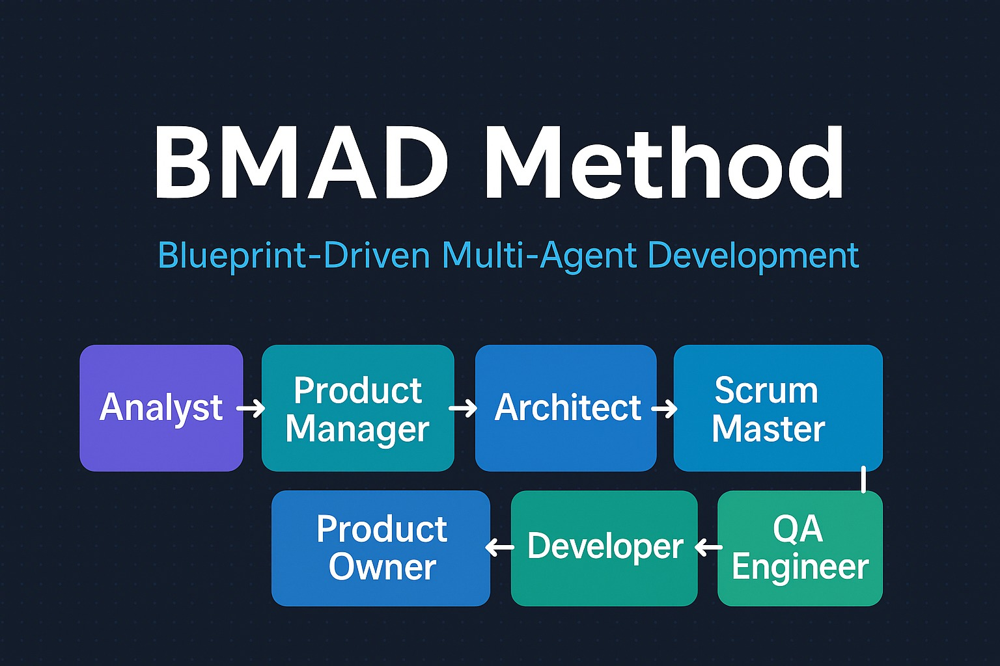

EBMAD-METHOD - framework open-source para organizar o ciclo de vida de desenvolvimento de software usando agentes de IA especializados, dividindo o trabalho em etapas ágeis diretamente dentro da IDE.

Blueprint-Driven Multi-Agent Development - arquitetura e guia de especificações técnicas usadas pelos Multiplos Agentes com suas respectivas responsabilidades, usando como fonte da verdade.

### Como Funciona
Substitui conversas longas por um fluxo de montagem documentada: Docs-as-Code.

- `Analyst & PM` é a parte de Descoberta e Requisitos onde se discute as ideias com o agente de produto e ele transforma o brainstorming em um PRD (Documento de Requisitos do Produto) detalhado com regra de negocio e escopo.

- `Architect` é onde o agente lê o PRD e escolhe as stack do projeto, modelos de dados, contratos de API e gera os ADR (Registros de Decisões de Arquitetura).

- `Scrum Master & PO` é onde o agente quebra o plano macro em Épicos e User Stories independentes, carregando o contexto arquitetural necessário para ser executado.

- `Dev & QA` é quando o agente desenvolvedor implementa uma história por vez seguindo o blueprint. Enquanto o QA revisa e valida a segurança, padrões de código e testes automatizados.

### Estrutura e Organização

