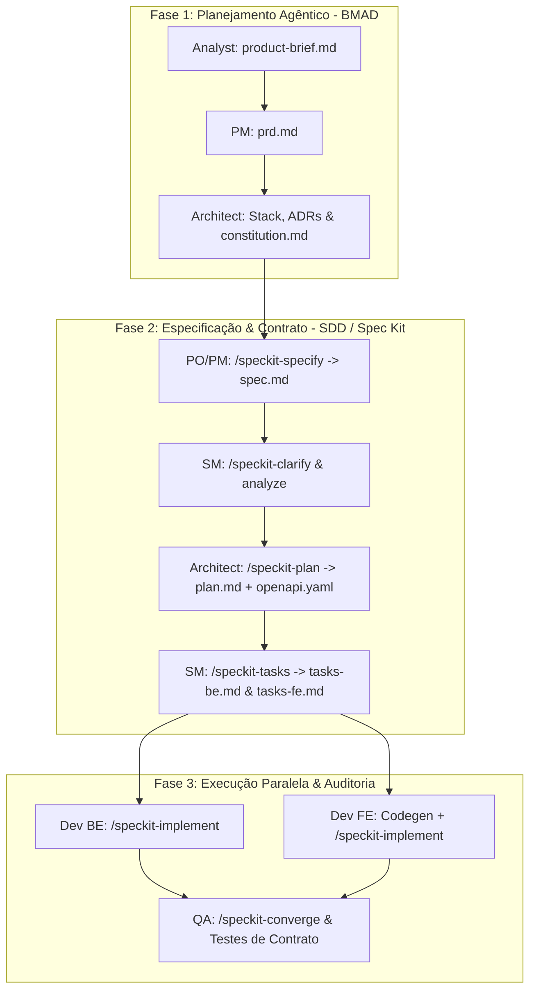

> **Instrução para a IA (Meta-Prompt):** Este documento é um **guia de referência metodológica unificada** que integra *Blueprint-Driven Multi-Agent Development* (BMAD), *Spec-Driven Development* (SDD) e a CLI do *GitHub Spec Kit* (`specify`). Ao utilizá-lo para estruturar o workspace, personas de subagentes (`.bmad-core/`), presets do Spec Kit (`.specify/`), especificações (`.specs/`), arquivos guias (`AGENTS.md`, `CLAUDE.md`, `.cursorrules`) ou pipelines de validação em um projeto, **não copie cegamente nomes de pastas, comandos ou exemplos ilustrativos** (`meu-sistema-workspace/`, `001-autenticacao/`, `Orval`, `Spectral`, `openapi.yaml`). Inspecione primeiro a estrutura real do ambiente atual para identificar:
> 1. **Natureza, Topologia e Maturidade da Stack:** Se o projeto é **Greenfield** (novo, onde a stack ainda será descoberta e decidida pelo subagente *Architect* após o *Analyst* e o *PM*) ou **Brownfield** (legado/existente, onde a stack já está travada); se opera como monorepo ou repositórios separados via *Umbrella Workspace* (frontend/backend/serviços); e qual o nível de rigor adequado (`Spec-First`, `Spec-Anchored` ou `Spec-as-Source`).
> 2. **Artefatos, CLIs e Ferramentas Reais:** Qual é a stack efetiva (ou se está em aberto), se o *GitHub Spec Kit* (`.specify/`) e o *BMAD* (`.bmad-core/`) já estão instalados, quais ferramentas de contrato/schema existem ou serão adotadas (REST/OpenAPI, GraphQL, gRPC/Protobuf, AsyncAPI, Zod/JSON Schema), quais frameworks de teste/codegen são usados e quais arquivos de instruções de agentes já existem.
> 3. **Fronteiras de Isolamento e Governança de Papéis:** Como os contratos devem ser posicionados como única fonte de verdade entre repositórios e como as permissões de escrita das personas devem ser isoladas (ex.: *Analyst/PM* restritos a negócio; *Architect* responsável por stack, ADRs e contratos; *Dev* restrito a código e testes; *QA* restrito à auditoria de convergência).
>
> A partir dessa análise, gere ou adapte a estrutura do workspace, os presets do Spec Kit, os prompts das personas do BMAD e as diretrizes de agentes de forma determinística e aderente à realidade deste projeto, garantindo estritamente:
> - **Cadeia de Decisão e Autonomia:** Em projetos *Greenfield* sem stack pré-definida, garanta que o *Analyst* (`product-brief.md`) e o *PM* (`prd.md`) operem sem viés tecnológico, permitindo ao *Architect* (`architecture.md`) decidir e justificar as stacks antes de congelá-las via `/speckit-constitution`.
> - **Separação entre Negócio e Execução:** Mantenha a **Intenção de Negócio** (`spec.md` via `/speckit-specify` com critérios *Given/When/Then* agnósticos) isolada do **Plano Técnico** (`plan.md` via `/speckit-plan`) e das **Tarefas Atômicas** (`tasks-be.md` / `tasks-fe.md` via `/speckit-tasks`).
> - **Isolamento de Contexto e Progressive Disclosure:** Estruture o arquivo raiz (`AGENTS.md` / `CLAUDE.md`) apenas como roteador enxuto, exigindo sessões limpas e carregamento sob demanda apenas dos contratos e tarefas pertinentes ao escopo do subagente ativo.
> - **Proteção contra Over-Engineering:** Preveja fluxos enxutos (como *quick-spec* ou extensões `/speckit-bug-*`) para ajustes triviais de UI, *hotfixes* ou explorações experimentais, evitando burocratizar mudanças de baixo risco.


Atualização 27/11/2026

# Spec-Driven + Blueprint-Driven

Essa combinação serve para resolver um problema entre perda de contexto e o desalinhamento entre equipes/agentes de Frontend e Backend. BMAD atua como um fluxo de linha em camadas, que organiza e divide o trabalho entre subagentes especializados, enquanto o SDD funciona como contratos de especificações estruturadas e rigorosas como única fonte da verdade - desde o planejamento até a geração e validação do código.


## Estrutura para Repositórios Separados (Frontend e Backend)
 
Para trabalhar com múltiplos repositórios sem sofrer com desatualização de contratos (spec drift), o mercado adota o padrão Umbrella / Parent Repo (Repositório Guarda-Chuva):

```text
meu-sistema-workspace/               # Repositório Central de Governança (Git)
├── .gitignore                       # Ignora as pastas backend/ e frontend/ clonadas aqui
├── .bmad-core/                      # Personas, workflows e regras do BMAD
├── .specify/                        # Templates, scripts e extensões do GitHub Spec Kit
├── .specs/                          # ÚNICA FONTE DA VERDADE (Blueprints + Contratos)
│   ├── constitution.md              # Leis globais (segurança, padrões, observabilidade)
│   ├── product-brief.md             # Visão de negócio (Gerado pelo BMAD Analyst)
│   ├── prd.md                       # Requisitos macro (Gerado pelo BMAD PM)
│   ├── architecture/                # Decisões sistêmicas e ADRs (BMAD Architect)
│   ├── contracts/                   # O ponto de encontro técnico
│   │   ├── openapi.yaml             # Contrato REST unificado
│   │   └── asyncapi.yaml            # Eventos/Mensageria
│   └── features/                    # Fatiamento por feature/épico
│       └── 001-autenticacao/
│           ├── spec.md              # Regras de negócio e Given/When/Then
│           ├── plan.md              # Plano técnico e ordem de rollout (Back -> Front)
│           ├── tasks-be.md          # Tarefas isoladas para o Backend
│           └── tasks-fe.md          # Tarefas isoladas para o Frontend
│
├── CLAUDE.md / AGENTS.md            # Roteador de contexto na raiz do workspace
├── backend/                         # Clone do repo 'meu-sistema-be' (Git próprio)
└── frontend/                        # Clone do repo 'meu-sistema-fe' (Git próprio)

```

- Por que funciona? Todos os desenvolvedores (e agentes) clonam o workspace e rodam um script simples que clona backend/ e frontend/ dentro dele. Os agentes ganham visibilidade transversal dos contratos sem misturar o histórico de commits de código com os commits de especificação.

## Fluxo Unificado (BMAD + SDD)




A união das metodologias divide o projeto em Planejamento Multi-Agente (BMAD) e Execução Contratual (SDD):

1. Descoberta e Visão (BMAD Analyst & PM): Você faz o brainstorming inicial com a persona de Analyst para gerar o product-brief.md e passa o bastão para o PM estruturar o prd.md completo.
2. Governança e Topologia (BMAD Architect + SDD Constitution): O Architect define a stack, modelagem de dados e registra os ADRs. Após aprovação humana do architecture.md, essas decisões são consolidadas no constitution.md (regras imutáveis do projeto). 
3. Fatiamento e Especificação (BMAD PO/SM + SDD Specify): O PO/SM quebra o PRD macro em features/épicos. Para cada feature, cria-se a spec.md (foco estrito no comportamento e cenários Given/When/Then, sem detalhes de framework).
4. Contratos e Plano Técnico (SDD Clarify & Plan): Antes de qualquer código, gera-se o plan.md e atualiza-se o .specs/contracts/openapi.yaml. O contrato passa por validação automática (ex: Spectral).
5. Decomposição Atômica (SDD Tasks): O plano é quebrado em checklists independentes (tasks-be.md e tasks-fe.md), cada um com critérios claros de conclusão.
6. Implementação Paralela e Auditoria (BMAD Dev/QA + SDD Converge): Subagentes isolados implementam as tarefas em paralelo nos repositórios backend/ e frontend/. O agente de QA valida a convergência contra a spec.md e roda testes de contrato.

## GitHub Spec Kit

O GitHub Spec Kit atua como o motor ferramental e de CLI que operacionaliza o SDD dentro da estrutura de personas do BMAD:

| Etapa do Fluxo | Papel do BMAD (Persona/Contexto) | Ferramenta no GitHub Spec Kit |
| :--- | :--- | :--- |
| **Setup & Regras** | *Architect* define padrões globais e restrições negativas. | `/speckit-constitution` grava as regras permanentes. |
| **Requisitos** | *PM / PO* fatiando o escopo sem poluição técnica. | `/speckit-specify` estrutura histórias e critérios de aceite. |
| **Refinamento** | *Scrum Master* checando lacunas antes da sprint. | `/speckit-clarify` e `/speckit-analyze` detectam ambiguidades e conflitos com a constituição. |
| **Arquitetura** | *Architect / UX Expert* desenhando APIs e estados de tela. | `/speckit-plan` gera o plano técnico e atualiza contratos. |
| **Execução** | *Dev* (sessão limpa) codando uma história por vez. | `/speckit-tasks` e `/speckit-implement` executam tarefas atômicas. |
| **Auditoria** | *QA* verificando aderência aos requisitos. | `/speckit-converge` valida se o código final converge 100% com a spec. |


Nota prática: Como o Spec Kit permite criar Presets e Extensions customizadas, você pode encapsular os templates e restrições negativas das personas do BMAD diretamente como comandos ou presets dentro da pasta .specify/.

## Relação entre Subagentes e Specs (Isolamento de Contexto)

Para evitar alucinações e gastos excessivos de tokens em projetos grandes, os subagentes seguem três regras rígidas na leitura das specs:

- Restrições Negativas de Papel: Cada persona tem permissão de escrita restrita. O agente de PM é proibido de editar arquivos em .specs/contracts/ ou código; o agente Dev é proibido de alterar a spec.md ou constitution.md por conta própria. Se encontrar uma falha na regra de negócio, o Dev deve parar e devolver o fluxo para o PM/Architect.

- Progressive Disclosure (Carregamento sob demanda): O arquivo raiz (CLAUDE.md ou AGENTS.md) funciona apenas como um mapa curto. O subagente de Backend lê apenas constitution.md, openapi.yaml e tasks-be.md — ele nunca lê os arquivos internos do repositório frontend/.

- Sessões Efêmeras (Clean Context): Nunca use o mesmo chat de planejamento para implementar. Ao terminar o /speckit-tasks, encerre a sessão, abra um agente limpo carregando apenas a tarefa atual e os contratos vinculados, execute e faça o commit.

## Melhores Práticas do Mercado

- Desenvolvimento Paralelo via Codegen e Mocks: Assim que o openapi.yaml é aprovado na fase de Plan, ferramentas como Orval ou openapi-typescript geram automaticamente os clientes HTTP, tipos TypeScript e servidores mockados (MSW) dentro de frontend/. O agente de Frontend constrói as telas imediatamente sem esperar a API real existir.

- Contrato como Gate de CI/CD: Configure pipelines no GitHub Actions tanto no repositório de Specs quanto nos repositórios de código. O PR do Backend só passa se os testes de contrato (ex: Specmatic ou Pact) provarem que as rotas reais respondem exatamente o que está no openapi.yaml.

- Scale-Adaptive Planning (Não burocratize tudo): Use o fluxo completo (BMAD Full + Spec Kit completo) apenas para a fundação do sistema e features complexas. Para ajustes pequenos de UI ou hotfixes pontuais, utilize fluxos enxutos (como /bmad-bmm-quick-spec ou a extensão /speckit-bug-assess do Spec Kit) para evitar gastar mais tempo escrevendo documentação do que resolvendo o problema.

- Mantenha a Spec Viva (Spec-Anchored): Adote a regra de que o código nunca é a fonte primária de documentação. Toda alteração de regra de negócio em produção exige abrir um PR primeiro no repositório .specs/ para atualizar o contrato e os critérios de aceite antes de tocar no código.

