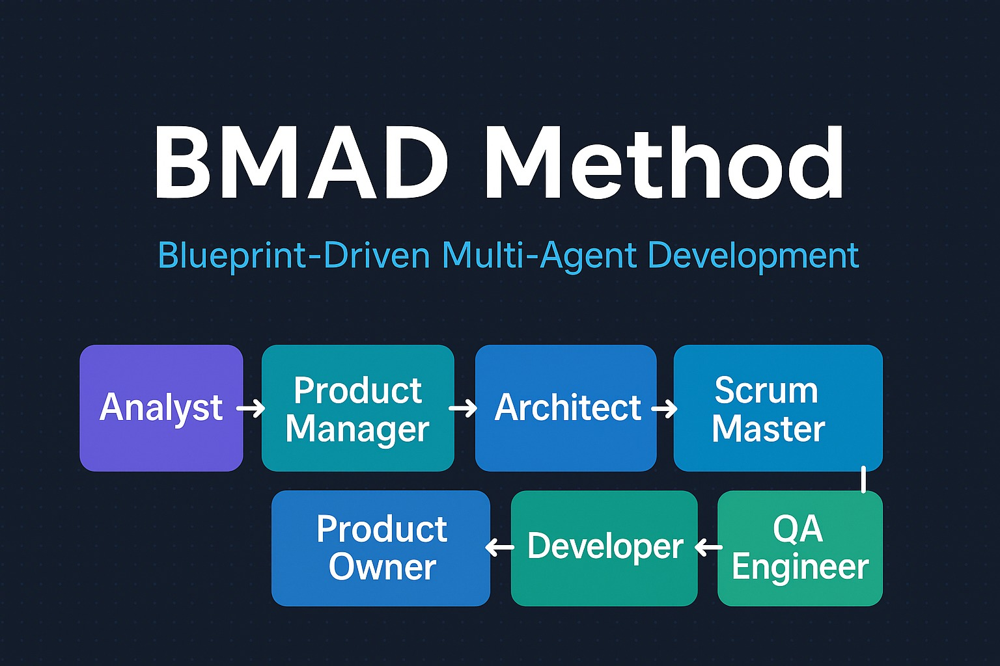

Blueprint-Driven Multi-Agent Development é um framework open-source de desenvolvimento orientado a especificações (Spec-Driven-Development) feito por uma linha de montagem estruturada de subagentes de IA especializados.

Funciona como uma camada de processo e engenharia de contexto, organizando o ciclo de vida do software em blueprints (Documentos Persistentes) que passam de um subagente para outro.

Ao invés de pedir para uma única IA fazer tudo em um chat longo (onde o contexto se perde e o modelo começa a alucinar), o BMAD divide o trabalho entre personas especializadas (Analista, PM, Arquiteto, Scrum Master, PO, Desenvolvedor e QA).

- Fonte única da verdade: Nenhuma decisão fica apenas no histórico efêmero do chat. Tudo é gravado em arquivos Markdown e YAML versionados no repositório Git (PRDs, diagramas de arquitetura, histórias de usuário).
- Separação rígida: O planejamento e a arquitetura são concluídos e validados por humanos antes que uma única linha de código seja escrita.

## Como Funciona?
Substitui conversas longas por um fluxo de montagem documentada: Docs-as-Code.

- `Analyst & PM` é a parte de Descoberta e Requisitos onde se discute as ideias com o agente de produto e ele transforma o brainstorming em um PRD (Documento de Requisitos do Produto) detalhado com regra de negocio e escopo.

- `Architect` é onde o agente lê o PRD e escolhe as stack do projeto, modelos de dados, contratos de API e gera os ADR (Registros de Decisões de Arquitetura).

- `Scrum Master & PO` é onde o agente quebra o plano macro em Épicos e User Stories independentes, carregando o contexto arquitetural necessário para ser executado.

- `Dev & QA` é quando o agente desenvolvedor implementa uma história por vez seguindo o blueprint. Enquanto o QA revisa e valida a segurança, padrões de código e testes automatizados.

## Como Usar?
A instalação padrão é feita via CLI (npx bmad-method install) diretamente na raiz do projeto, criando pastas de configuração (.bmad-core ou _bmad-output) com prompts, templates e workflows. Para extrair o máximo de eficiência com as ferramentas atuais:

- Use o arquivo project-context.md: Crie esse arquivo na raiz antes de rodar qualquer agente para travar regras globais (versões de bibliotecas, padrões de lint, convenções de nomenclatura).

- Aplique o Scale-Adaptive Planning: Não use o fluxo pesado para tudo. Para features complexas ou projetos do zero (Greenfield), use o Full Method. Para correções de bugs ou pequenas melhorias, use o Quick Flow (/bmad-bmm-quick-spec), que gera uma especificação técnica enxuta e vai direto para o código.

- Fragmentação de Contexto (Sharding): Nunca passe um PRD gigante inteiro para o agente desenvolvedor. Use o Product Owner/Scrum Master para fatiar o PRD em arquivos menores de Épicos e Histórias (Stories) autocontidas, economizando tokens e mantendo a precisão do modelo.

- Regra de Ouro da Imutabilidade: Se durante o desenvolvimento surgir uma dúvida não prevista, não peça para o Dev improvisar. Volte ao PRD ou Documento de Arquitetura, atualize a especificação com o PM/Arquiteto e regenere a Story.

## Estrutura e Organização Frontend e Backend

```

meu-projeto/
├── .bmad-core/                  # Personas, templates e workflows do BMAD
├── docs/                             # Blueprints (Fonte da Verdade)
│   ├── project-brief.md      # Visão de negócio (Analyst)
│   ├── prd.md                    # Requisitos funcionais e não-funcionais (PM)
│   ├── architecture.md          # Stack, banco, microsserviços e APIs (Architect)
│   ├── ui-ux-spec.md            # Design system, fluxos e wireframes (UX Expert)
│   ├── epics/                      # Épicos fatiados (PO)
│   └── stories/                   # Tarefas atômicas prontas para código (SM)
├── backend/                     # Implementação orientada aos schemas do architecture.md
└── frontend/                    # Implementação orientada ao ui-ux-spec.md e contratos de API
```

- No Backend: O Architect define previamente o esquema do banco de dados, regras de autenticação, contratos OpenAPI/Swagger e estrutura de pastas. O Dev backend apenas implementa cada Story seguindo estritamente esses contratos.

- No Frontend: O agente UX Expert cria a especificação de componentes, estados de tela e fluxos antes do código. O Dev frontend consome os mesmos tipos/contratos de API definidos na arquitetura para evitar desalinhamento de payload.


## Fluxo de Camadas e Trabalho



Conforme ilustrado no diagrama que você compartilhou, o método opera em duas grandes fases divididas em camadas sequenciais com Quality Gates (validação humana entre etapas):  

Fase 1: Planejamento Agêntico (Agentic Planning - Linha Superior)
•   Analyst: Faz brainstorming, pesquisa de mercado e transforma uma ideia vaga em um Project Brief.
•   Product Manager (PM): Converte o brief em um PRD completo com requisitos, métricas e regras de negócio.
•   Architect: Lê o PRD e projeta a topologia do sistema, escolha de stack, modelagem de dados e segurança (architecture.md).
•   Scrum Master (SM) & Product Owner (PO): Validam a consistência entre negócio e arquitetura, fatiando o plano em Épicos e Stories detalhadas com critérios de aceite claros.

Fase 2: Desenvolvimento Orientado a Contexto (Linha Inferior)
• QA Engineer: Atua criando planos de teste, cenários de borda e revisando a testabilidade antes ou logo após o código.
• Developer (Dev): Abre uma nova sessão de chat limpa para cada Story, carrega apenas o arquivo daquela história e a arquitetura relevante, escreve o código e roda os testes unitários.
• Ciclo de Revisão: O QA/Reviewer audita o código gerado contra os critérios de aceite da Story e do architecture.md antes de aprovar o Pull Reques

### Função do Orquestrador e dos Subagentes

O Orquestrador (bmad-orchestrator / bmad-master):
• Atua como o roteador central e gerente de estado do projeto.
• Ele identifica em qual estágio o projeto está, recomenda qual persona deve ser ativada a seguir, gerencia os handoffs (passagem de bastão entre documentos) e garante que nenhuma etapa crítica seja pulada.
• Em IDEs modernas (como Claude Code ou Cursor), ele invoca comandos/skills específicos para carregar o contexto exato daquela fase.

Os Subagentes (Personas Especializadas):
• Cada subagente é um arquivo de configuração (Markdown + YAML) com restrições negativas estritas (ex: o PM é proibido de escrever código; o Dev é proibido de alterar a arquitetura por conta própria).
• Por que funcionam tão bem? Ao limpar a janela de contexto a cada troca de subagente e alimentar o modelo apenas com o artefato gerado pelo agente anterior, elimina-se a "poluição de contexto", mantendo a atenção do LLM focada 100% na tarefa atual (seja modelar um banco SQL ou estilizar um componente React).
