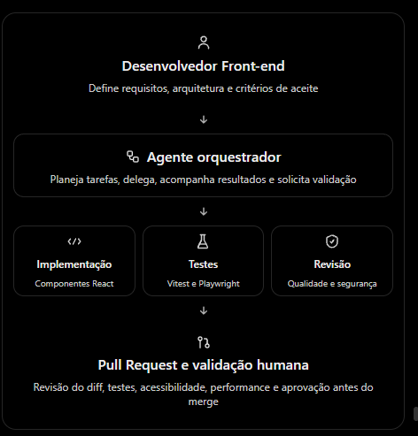

# Roadmap Front-end — conteúdo de referência

Fonte: material enviado pelo ponto focal. Este documento reúne conteúdo de aprendizado e exercícios que serão acompanhados no Kaizen.

## Projetos progressivos

Catálogo inicial recebido com quatro projetos. Os checklists de conclusão abaixo desdobram os resultados descritos no material enviado; as caixas representam critérios, sem registrar conclusão pessoal do usuário.

Os tópicos indicados são referências de estudo. No cadastro, cada projeto deverá apontar os conteúdos concretos abordados; a confirmação da prática segue a [visão do produto](../visao-produto.md#relação-entre-projetos-e-prática-dos-conteúdos).

### Projeto 1 — Landing page profissional

**Fase:** Base. **Conhecimentos:** HTML, CSS e JavaScript. **Tópicos de referência:** 1, 2, 8 e 12.

**Entrega:** interface responsiva, componentes visuais, formulário acessível, boas práticas de SEO e deploy.

- [ ] A interface se adapta a celular e desktop.
- [ ] Os componentes visuais previstos estão implementados.
- [ ] As interações em JavaScript funcionam nos fluxos da página.
- [ ] O formulário é acessível e permite uso por teclado.
- [ ] As práticas de SEO da página foram aplicadas e verificadas.
- [ ] A página está publicada e pode ser acessada no ambiente de deploy.

### Projeto 2 — Dashboard com autenticação

**Fase:** Profissional. **Conhecimentos:** React, TypeScript e Vite. **Tópicos de referência:** 2, 3, 4, 5, 7 e 8.

**Entrega:** dashboard com autenticação, navegação, consumo de API, filtros, formulários, gerenciamento de estado, testes e integração contínua.

- [ ] O fluxo de autenticação está implementado.
- [ ] A navegação permite acessar as telas previstas.
- [ ] O dashboard consome a API necessária ao seu fluxo principal.
- [ ] Os filtros e formulários funcionam com os dados apresentados.
- [ ] O gerenciamento de estado mantém os dados coerentes entre as interações.
- [ ] Os fluxos principais possuem testes executados com sucesso.
- [ ] A integração contínua executa as verificações definidas para o projeto.

### Projeto 3 — Biblioteca de componentes

**Fase:** Profissional. **Conhecimentos:** Design System, Storybook e CI/CD. **Tópicos de referência:** 3, 5, 7, 8, 9 e 12.

**Entrega:** tokens de design, componentes acessíveis, testes visuais, documentação e publicação de um pacote npm.

- [ ] Os tokens de design orientam os estilos dos componentes.
- [ ] Os componentes implementam os comportamentos de acessibilidade previstos.
- [ ] Os testes visuais verificam os componentes e suas variantes.
- [ ] A documentação no Storybook apresenta os componentes e seus usos.
- [ ] O fluxo de CI/CD verifica e prepara a entrega da biblioteca.
- [ ] O pacote está publicado no npm.

### Projeto 4 — Plataforma modular de grande porte

**Fase:** Especialização. **Conhecimentos:** Next.js, rendering e Micro-frontends. **Tópicos de referência:** 3, 6, 8, 10, 11, 12 e 13.

**Entrega:** aplicação com diferentes estratégias de renderização, módulos independentes, observabilidade, performance e entregas automatizadas.

- [ ] Diferentes estratégias de renderização estão aplicadas nas partes previstas da plataforma.
- [ ] Os módulos apresentam responsabilidades e integração definidas.
- [ ] Os recursos de observabilidade permitem acompanhar a operação da plataforma.
- [ ] A avaliação de performance e os resultados das melhorias estão registrados.
- [ ] As entregas são realizadas por um fluxo automatizado.

## Trilha principal de estudo

HTML + CSS + TypeScript + React + Vite + React Router + TanStack Query + Vitest/Testing Library + Playwright + GitHub Actions.

Depois dessa base, aprofundar Next.js, Design Systems e arquitetura avançada. Angular, Vue e Svelte aparecem como alternativas de estudo, sem exigir domínio simultâneo de todas as stacks.

Essa stack descreve a trilha de aprendizado do usuário. As decisões técnicas para construir o Kaizen serão registradas na camada de arquitetura.

## 15. Inteligência Artificial aplicada ao desenvolvimento Front-end

**Abrangência:** básico ao avançado, como tópico transversal. **Objetivo:** orientar assistentes inteligentes, automatizar tarefas de desenvolvimento, coordenar agentes e validar tecnicamente o resultado.

Engenharia de Prompt trata da formulação de instruções. Orquestração de IA trata do planejamento e da coordenação de agentes, ferramentas, contexto, permissões, validações e execução. A IA complementa os conhecimentos técnicos do desenvolvedor.

### 15.1 Engenharia de Prompt

- [ ] Fundamentos de IA generativa e LLMs
- [ ] Tokens, janela de contexto e limitações dos modelos
- [ ] Estrutura de prompts: contexto, objetivo, restrições e saída
- [ ] Role Prompting, Zero-Shot e Few-Shot Prompting
- [ ] Prompts com exemplos, critérios de aceite e formatos de resposta
- [ ] Prompt Chaining e decomposição de tarefas
- [ ] Metaprompts e templates reutilizáveis
- [ ] Solicitar explicações, alternativas e justificativas técnicas
- [ ] Criar prompts para React, TypeScript, CSS e APIs
- [ ] Refinar respostas e verificar suposições da IA

### 15.2 Context Engineering

- [ ] Diferenças entre Prompt Engineering e Context Engineering
- [ ] Organizar documentação, requisitos e convenções do repositório
- [ ] Criar instruções persistentes por projeto
- [ ] Selecionar arquivos e trechos relevantes
- [ ] Gerenciar limites da janela de contexto
- [ ] Compactação e resumos de sessões longas
- [ ] Evitar contexto desnecessário ou desatualizado
- [ ] Reutilizar prompts, skills e padrões de projeto
- [ ] Monitorar consumo de tokens e custos
- [ ] Preservar decisões técnicas ao longo de tarefas

### 15.3 Ferramentas de programação com IA

- [ ] GitHub Copilot e sugestões de código
- [ ] ChatGPT para explicação e resolução de problemas
- [ ] Claude Code para tarefas em repositórios
- [ ] Cursor: modos Ask, Edit e Agent
- [ ] Google Antigravity: planejamento e agentes
- [ ] Gerar componentes React com TypeScript
- [ ] Converter protótipos Figma em interfaces
- [ ] Refatorar código e investigar bugs
- [ ] Gerar testes unitários e E2E
- [ ] Criar documentação e comentários úteis
- [ ] Revisar diffs e validar alterações antes de aceitar

### 15.4 Agentes e Orquestração de IA

- [ ] Diferenças entre assistente, agente e orquestrador
- [ ] Tool Calling e agentes que executam ferramentas
- [ ] Planejamento, execução, observação e validação
- [ ] Delegação de tarefas a agentes especializados
- [ ] Padrões Supervisor e Orchestrator-Worker
- [ ] Subagentes e isolamento de contexto
- [ ] Execução sequencial versus paralela
- [ ] Separação de tarefas com Git Worktrees
- [ ] Agentes para implementação, revisão e testes
- [ ] Controle de permissões, checkpoints e aprovações humanas
- [ ] Estratégias de retry, fallback e recuperação de falhas
- [ ] Coordenação de custos, resultados e critérios de conclusão

### 15.5 MCP, Skills e automações

- [ ] Model Context Protocol (MCP): arquitetura e funcionamento
- [ ] MCP Client, MCP Server, Tools e Resources
- [ ] Conectar agentes ao GitHub e às ferramentas de desenvolvimento
- [ ] Integração com Figma e documentação técnica
- [ ] Criar ferramentas personalizadas com Node.js e TypeScript
- [ ] Skills reutilizáveis para tarefas recorrentes
- [ ] Hooks e validações antes e depois da execução
- [ ] Workflows automatizados para build, lint e testes
- [ ] Integração supervisionada de agentes com pipelines CI/CD
- [ ] Credenciais, permissões mínimas e proteção de dados

### 15.6 Desenvolvimento e qualidade com IA

- [ ] Spec-Driven Development (SDD)
- [ ] Escrever especificações e critérios de aceite antes de gerar código
- [ ] Planos de implementação e mudanças incrementais
- [ ] Test-Driven Development (TDD) assistido por IA
- [ ] Revisão de código gerado e identificação de alucinações
- [ ] Testes automatizados como guardrails
- [ ] Análise estática com ESLint e TypeScript
- [ ] Validação de acessibilidade, responsividade e performance
- [ ] Segurança: XSS, exposição de dados e dependências vulneráveis
- [ ] Evitar compartilhar segredos e código confidencial sem autorização
- [ ] Harness Engineering: controle e verificação de agentes
- [ ] Avaliar produtividade por qualidade, retrabalho e entrega, não linhas geradas

## Prioridade de estudos em IA

1. Engenharia de Prompt e Context Engineering, inclusive no uso de um único assistente.
2. Escolher uma ferramenta principal de desenvolvimento com IA e aplicá-la em projetos reais.
3. Aprofundar orquestração, MCP e automações com supervisão.
4. Manter qualidade e validação em todas as etapas: revisar código, executar testes, investigar resultados e controlar alterações.

A prática de IA pode ser demonstrada nos quatro projetos por meio do código, dos registros de trabalho e das validações realizadas. No cadastro do projeto, devem ser selecionados os conteúdos de IA realmente abordados, seguindo as mesmas regras de confirmação da prática dos demais tópicos.

## Referência visual de orquestração

A imagem ilustra o desenvolvedor definindo requisitos, arquitetura e critérios; um orquestrador coordenando implementação, testes e revisão; e uma entrega em pull request com validação humana. É uma referência de trabalho para os estudos de IA.
