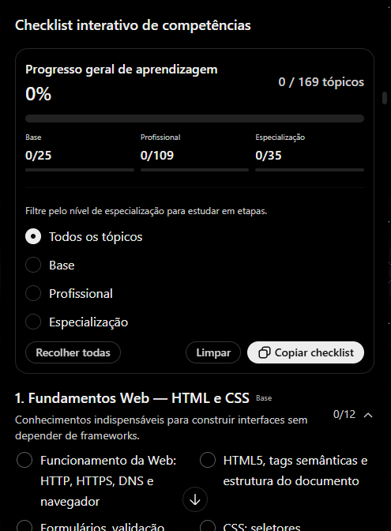

# Visão do produto Kaizen

Status: contexto inicial com regras gerais, catálogo de quatro projetos e checklist de IA recebidos. Os vínculos com conteúdos concretos serão definidos no cadastro.

## Problema, propósito e usuário

O usuário quer monitorar e organizar o próprio progresso nos roadmaps por áreas de atuação, com tópicos dentro de cada área e conteúdos dentro dos tópicos. O Kaizen será um sistema web para acompanhar esse percurso e consolidar as competências em projetos práticos.

O proponente é o ponto focal do projeto e será o usuário que utilizará o sistema para acompanhar o próprio aprendizado.

## Uso atual e referência visual

Atualmente, o usuário usa um sistema simples dentro do ChatGPT para organizar e visualizar o progresso dos estudos.

Na captura fornecida, estão visíveis:

- Um checklist interativo de competências.
- Progresso geral em percentual e quantidade concluída em relação ao total.
- Contadores para Base, Profissional e Especialização, com filtros por esses agrupamentos.
- Blocos de conteúdo expansíveis, com uma lista de itens marcáveis.
- Controles com os rótulos Recolher todas, Limpar e Copiar checklist.

A imagem exibe 0% e um contador de 0/169 denominado “tópicos”, além dos totais 25, 109 e 35 para os agrupamentos visíveis. Esses valores descrevem a referência recebida. No Kaizen, a unidade dos contadores de checklist será conteúdo; os quinze grandes blocos serão chamados de tópicos.

A limitação relatada pelo usuário é a falta de funcionalidades e praticidade. Para a primeira versão web, ele precisa poder adicionar ou criar áreas, tópicos e conteúdos. Também precisa de um lugar para projetos relacionados aos tópicos, indicando explicitamente quais conteúdos cada projeto aborda.

## Organização dos estudos

A organização adotada para a primeira versão é: **área de atuação → roadmap da área → fases de aprendizado → tópicos → conteúdos em checklist**.

- Cada área, como Desenvolvimento Frontend, terá um roadmap de aprendizado na primeira versão.
- Base, Profissional e Especialização serão as fases iniciais desse roadmap, em ordem de evolução. As fases organizam os tópicos e permitem filtrar o percurso.
- Cada tópico pertence a uma fase; seus conteúdos herdam essa organização. O usuário poderá ajustar a organização das fases e a posição dos tópicos.
- As fases orientam a sequência. O usuário pode estudar e realizar projetos fora dessa ordem; os conhecimentos necessários são orientativos e se referem ao estudo dos conteúdos.
- O projeto prático pode ser iniciado enquanto o tópico aguarda a demonstração prática necessária à conclusão, evitando dependência circular.

O [glossário](glossario.md) registra a linguagem adotada. As fases de aprendizado são distintas das entregas do produto registradas em [roadmap.md](roadmap.md).

## Roadmap de referência — Desenvolvimento Frontend

O usuário apresentou os seguintes tópicos, nesta ordem:

1. HTML e CSS
2. JavaScript e TypeScript
3. Frameworks e Bibliotecas
4. Tecnologias e Integrações
5. Build e Automação
6. Arquitetura Frontend
7. Testes, Qualidade e Segurança
8. CI/CD e Deploy
9. Design Systems
10. Rendering Patterns
11. Micro-Frontends
12. Performance, SEO e Acessibilidade
13. PWA, Observabilidade e Produção
14. Colaboração e Evolução Profissional
15. Inteligência Artificial aplicada ao desenvolvimento Front-end

Os conteúdos de cada tópico são representados em checklist. O [material de referência](referencias/roadmap-frontend.md) contém os 65 itens recebidos para o tópico 15, distribuídos em seis grupos. Os itens dos demais tópicos serão cadastrados pelo usuário.

IA é o 15º tópico do roadmap Front-end e complementa os conhecimentos técnicos. Para organização, permanece na fase Profissional; seu estudo é transversal, do básico ao avançado, seguindo a prioridade indicada no material.

## Cálculo do progresso

O acompanhamento apresentará dois indicadores separados, com quantidade concluída/total e percentual por tópico, fase e roadmap:

- **Estudo:** conteúdos marcados como estudados ÷ conteúdos cadastrados no escopo × 100.
- **Prática:** conteúdos com prática validada em projetos concluídos ÷ conteúdos cadastrados no escopo × 100.

Cada conteúdo tem o mesmo peso. Nos agregados de fase e roadmap, o cálculo usa todos os conteúdos do respectivo escopo. Um conteúdo abordado em vários projetos conta uma única vez na cobertura prática.

Um tópico só é concluído quando possui conteúdos, seu checklist está completo e a prática de todos esses conteúdos foi validada. Fase e roadmap são concluídos quando possuem tópicos e todos os seus tópicos estão concluídos.

Escopos sem conteúdos mostram 0% e indicação de ausência de conteúdos, sem conclusão automática. Os valores e a conclusão são recalculados ao marcar ou desmarcar itens, cadastrar conteúdos ou alterar a validade da prática.

Exemplo: um tópico com cinco conteúdos estudados tem 100% de estudo. Se projetos concluídos cobrem apenas três deles, sua prática é de 60% e o tópico continua aguardando prática.

## Facilidade e dificuldade

Cada conteúdo pode receber uma avaliação opcional: **Tenho Dificuldade** ou **Tenho Facilidade**. A ausência de avaliação será apresentada como Não avaliado.

O usuário pode atribuir, alterar ou remover a avaliação no próprio item. Filtros por dificuldade, facilidade e ausência de avaliação ajudam a localizar assuntos para revisão e organizar o próximo estudo.

A avaliação é pessoal e independente dos indicadores de estudo e prática: ela não altera pesos, não conclui conteúdos ou tópicos e não bloqueia o percurso.

## Projetos práticos e progressão

Cada projeto se relaciona a um roadmap e pode abranger conteúdos de vários tópicos desse roadmap. Ele deve apresentar nome, objetivo, conhecimentos necessários, conteúdos abordados, resultado esperado e checklist de critérios de conclusão.

Os projetos são progressivos: aproveitam conhecimentos anteriores e introduzem práticas mais avançadas. Seus conhecimentos necessários orientam a escolha da prática, e os conteúdos abordados identificam exatamente o que será demonstrado.

O projeto terá os estados **Não iniciado**, **Em andamento** e **Concluído**. Seu avanço mostra critérios cumpridos/total e percentual, com peso igual por critério. É necessário pelo menos um critério para permitir a conclusão.

Todos os critérios devem estar cumpridos antes de o usuário confirmar manualmente que o resultado foi demonstrado e concluir o projeto. O registro guarda essa confirmação e sua data; links para repositório ou aplicação e observações sobre a entrega são opcionais.

## Relação entre projetos e prática dos conteúdos

- Os conteúdos abordados são vinculados aos itens já cadastrados no roadmap. Selecionar apenas o tópico não valida automaticamente todos os seus conteúdos.
- Um projeto pode cobrir vários conteúdos e um conteúdo pode aparecer em vários projetos.
- A confirmação de conclusão do projeto valida a prática dos conteúdos explicitamente vinculados a ele. Um projeto ainda em andamento não valida a prática desses conteúdos.
- Um ou vários projetos concluídos podem completar a cobertura prática de um tópico. O tópico será concluído quando todos os seus conteúdos também estiverem estudados.
- Reabrir um projeto remove sua contribuição à cobertura prática; conteúdos cobertos por outro projeto concluído continuam validados. As conclusões afetadas são recalculadas.
- Alterar os critérios ou os conteúdos abordados de um projeto concluído exige reabertura e nova confirmação. Desmarcar um critério devolve um projeto concluído ao estado Em andamento.

Conceitos podem ser demonstrados em uma decisão explicada, documentação, configuração ou comportamento da entrega, conforme os critérios do projeto. A comprovação inicial é feita pelo próprio usuário.

## Catálogo inicial e trilha de estudo

O [material de referência Front-end](referencias/roadmap-frontend.md#projetos-progressivos) reúne os quatro projetos enviados: Landing page profissional, Dashboard com autenticação, Biblioteca de componentes e Plataforma modular de grande porte.

O catálogo apresenta fases, conhecimentos e entregas. Seus checklists de conclusão desdobram os escopos recebidos. Os tópicos de referência orientam o cadastro; a confirmação da prática exige os vínculos com conteúdos concretos, conforme as regras acima.

A [trilha principal de estudo](referencias/roadmap-frontend.md#trilha-principal-de-estudo) reúne HTML, CSS, TypeScript, React, Vite e ferramentas relacionadas. Ela descreve o percurso de aprendizado; a arquitetura técnica do Kaizen será definida na camada própria.

## Conteúdo de IA e referência de orquestração

O tópico 15 contém Engenharia de Prompt, Context Engineering, ferramentas de programação com IA, agentes e orquestração, MCP/Skills/automações e desenvolvimento e qualidade com IA.

O estudo começa por Prompt e Context Engineering, avança para uma ferramenta principal aplicada em projetos e depois aprofunda orquestração, MCP e automações. Qualidade e validação acompanham todas as etapas.

A [imagem de orquestração](referencias/roadmap-frontend.md#referência-visual-de-orquestração) ilustra o desenvolvedor definindo requisitos e validando a entrega, com agentes apoiando implementação, testes e revisão nos exercícios de IA.

## Situação do conteúdo e vínculos

O catálogo de projetos e o checklist de IA já foram recebidos. Os conteúdos dos tópicos 1 a 14 e os vínculos exatos entre conteúdos e projetos serão registrados no cadastro. Referenciar um tópico ou grupo de IA não valida automaticamente seus itens.

O [roadmap do produto](roadmap.md) registra esse conteúdo inicial e as capacidades da primeira entrega.
